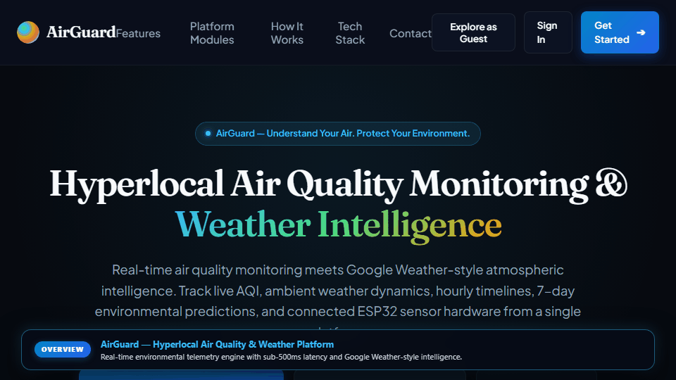

# AirGuard — IoT-Based Hyperlocal Air Quality Monitoring and Alert System

Official full-stack IoT and cloud engineering codebase accompanying the base paper:
**"IoT-Based Hyperlocal Air Quality Monitoring and Alert System with Cloud Integration"**

[](https://airguard-hyperlocal.vercel.app)
[](mailto:airguard396@gmail.com)
[](https://airguard-hyperlocal.vercel.app)

---

## 📺 Live Platform Walkthrough & Interactive Demo

> **Watch AirGuard in Action:** Real-time 0–500 EPA AQI circular gauge, Google Weather atmospheric forecasts, multi-node IoT hardware registry, interactive micro-zones, automated compliance audits, and full daylight/obsidian theme switching.

<div align="center">
  <a href="https://airguard-hyperlocal.vercel.app" target="_blank" rel="noopener noreferrer">
    
  </a>
  <p align="center">
    <sub>⚡ <em>Animated demo walkthrough playing live. Click the preview above to explore the live deployment at <a href="https://airguard-hyperlocal.vercel.app"><strong>airguard-hyperlocal.vercel.app</strong></a></em></sub>
  </p>
</div>

---

## 🏗️ System Architecture

```text
                                AIRGUARD PLATFORM
                                        │
                       ┌────────────────┴────────────────┐
                       │                                 │
              REACT WEB DASHBOARD              FLUTTER MOBILE APP
             (React 18 / Vite / Recharts)      (Android / iOS Native)
                       │                                 │
                       └────────────────┬────────────────┘
                                        │
                            Node.js / Express REST API
                                        │
                           MongoDB Atlas Cloud Database
                                        │
                           Socket.IO Real-Time Engine
                                        │
                         ESP32 Micro-Station & Transducers
                             (MQ-135 Gas + DHT22 Climate)
```

---

## 📂 Repository Structure

```text
AirQuality-Project/
├── Arduino/AirQualityNode/   ESP32 firmware — MQ-135 (GPIO 34) + DHT22 (GPIO 27) sensing node
├── Backend/                  Node.js / Express REST API, MongoDB Atlas schemas, Socket.IO
├── Frontend/                 React / Vite Web Dashboard, Recharts trends, Compliance reports
├── Flutter/                  Flutter cross-platform mobile client for Android & iOS
└── tools/                    Automated diagnostic utilities
```

---

## 🚀 Quick Start Guide

### 1. Backend & Live Simulator
```bash
cd Backend
npm install
npm run dev
# In another terminal:
npm run simulate
```

### 2. React Web Dashboard
```bash
cd Frontend
npm install
npm run dev
```
Open [http://localhost:5173](http://localhost:5173) in your browser.

### 3. Flutter Mobile Client
```bash
cd Flutter
flutter pub get
flutter run
```
To build the Android release APK:
```bash
flutter build apk --release
```

### 4. Hardware Deployment (ESP32)

#### Pin Assignments
| Component | ESP32 Pin | Interface | Function |
|---|---|---|---|
| **MQ-135 Gas Sensor** | GPIO 34 | Analog (ADC1) | Ambient Gas & Air Quality (CO2, NH3, Benzene) |
| **DHT11 / DHT22** | GPIO 27 | Digital GPIO | Ambient Temperature & Relative Humidity |
| **Status LED** | GPIO 2 | Output GPIO | Acquisition & Wi-Fi Transmission Pulse |

#### Flashing Instructions
1. Open `Arduino/AirQualityNode/AirQualityNode.ino` in Arduino IDE or compile via `arduino-cli`.
2. Configure Wi-Fi SSID and Password in `config.h`.
3. Set your target backend endpoint (e.g. `http://<your-lan-ip>:5001/api/readings` or production cloud URL).
4. Connect ESP32 via micro-USB data cable and flash at 115200 baud.

---

## 🧪 Comprehensive End-to-End System Audit

Run the automated verification suite covering health, auth lifecycle, data isolation, telemetry, alerts, and geocoding:

```bash
node Backend/scripts/audit_e2e_verification.js
```

---

## ⚙️ Environment Variables

### Backend (`Backend/.env`)
| Variable | Description |
|---|---|
| `PORT` | API Port (Default: `5001`) |
| `NODE_ENV` | `development` or `production` |
| `MONGO_URI` | MongoDB Atlas Connection String |
| `JWT_SECRET` | Secret key for JWT signing |
| `API_KEY` | Shared secret header (`x-api-key`) for ESP32 telemetry ingestion |
| `GOOGLE_WEATHER_API_KEY` | Google Maps Geocoding / Weather key |

### Frontend (`Frontend/.env`)
| Variable | Description |
|---|---|
| `VITE_API_URL` | Backend server base URL (e.g. `http://localhost:5001`) |
| `VITE_GOOGLE_CLIENT_ID` | Google OAuth Client ID |

---

## 📬 Contact & Support

For technical inquiries, academic research collaboration, custom sensor deployments, or API access:

- **Official Email**: [`airguard396@gmail.com`](mailto:airguard396@gmail.com)
- **Live Deployment**: [airguard-hyperlocal.vercel.app](https://airguard-hyperlocal.vercel.app)
- **Base Research Paper**: *"IoT-Based Hyperlocal Air Quality Monitoring and Alert System with Cloud Integration"*
- **Lead Developer**: Harsha ([harsha895155@gmail.com](mailto:harsha895155@gmail.com))

---

## 📄 License & Attribution

This project is licensed for academic, environmental research, and institutional monitoring use. When using or referencing this codebase or hardware design, please cite the accompanying IEEE paper.

