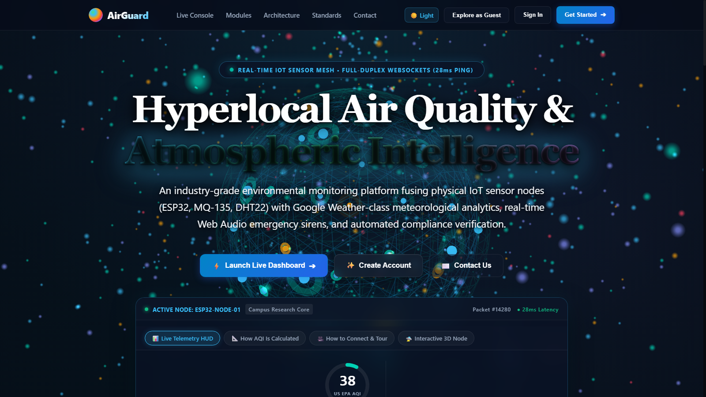
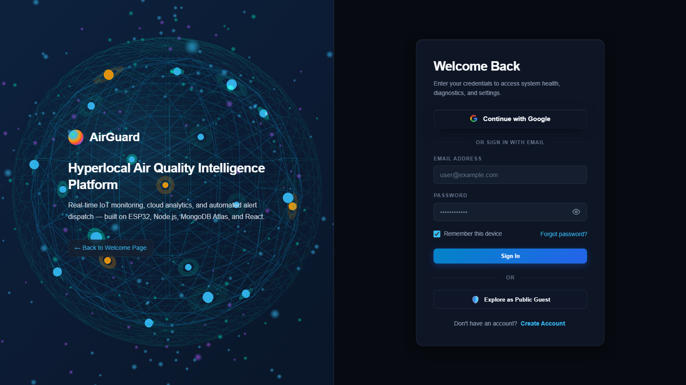
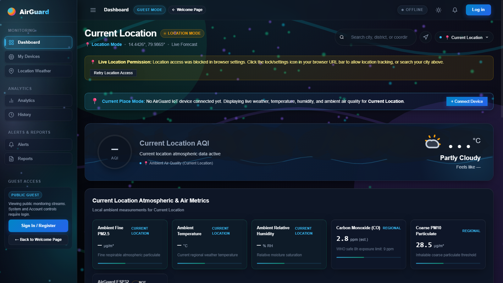
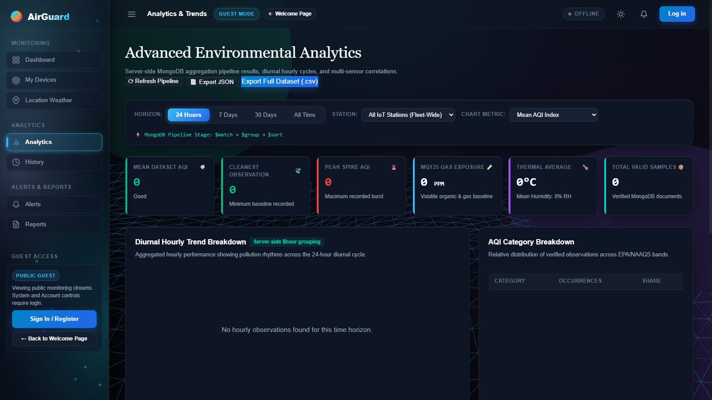
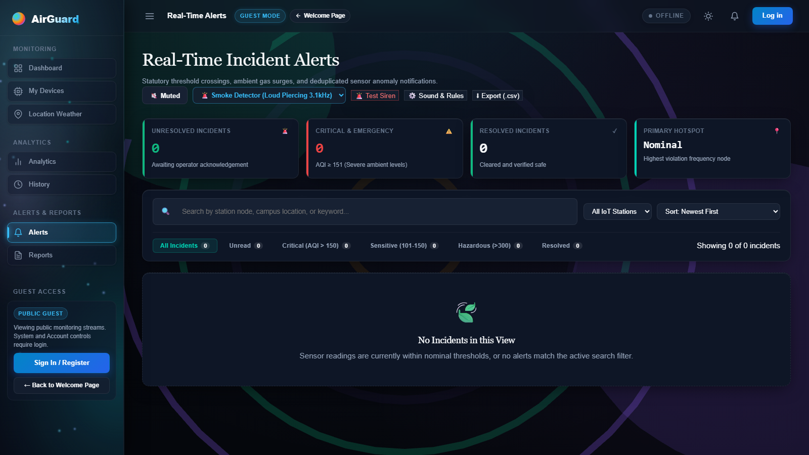
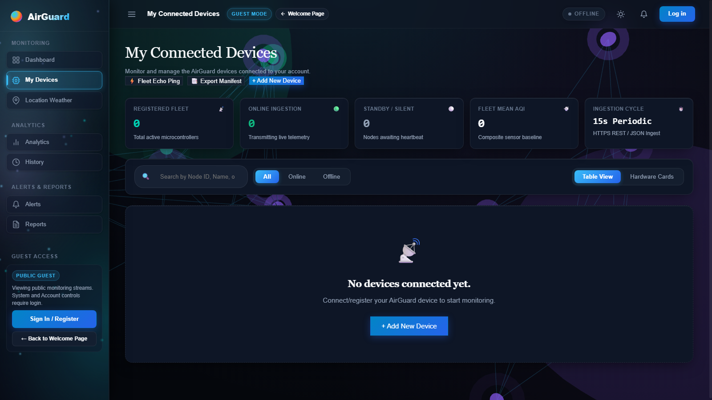
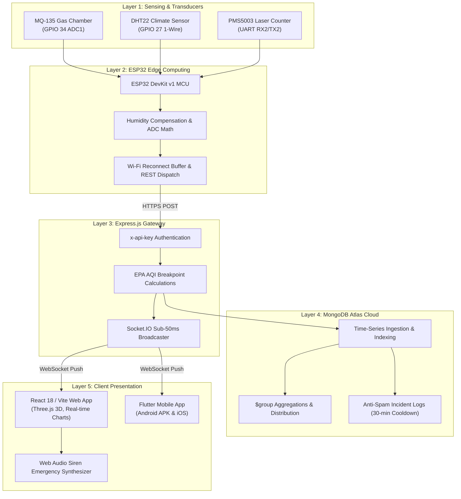

<div align="center">

# 🌍 AirGuard — IoT-Based Hyperlocal Air Quality Monitoring & Alert System

**Real-Time Street-Level Environmental Telemetry, 3D WebGL Digital Twin, Smart Anti-Spam Alerts & Cloud Intelligence**

[](https://airguard-hyperlocal.vercel.app)
[](https://threejs.org/)
[](https://reactjs.org/)
[](https://nodejs.org/)
[](https://www.mongodb.com/)
[](https://www.espressif.com/)
[](mailto:airguard396@gmail.com)
[](#-license--attribution)

<p align="center">
  <a href="https://airguard-hyperlocal.vercel.app"><strong>🚀 Explore Live Web App</strong></a> •
  <a href="https://airguard-hyperlocal.vercel.app/dashboard"><strong>⚡ Instant Guest Mode</strong></a> •
  <a href="#-interactive-platform-walkthrough--video-demo"><strong>🎬 Video & 3D Demo</strong></a> •
  <a href="#-3d-webgl-atmospheric-engine-threejs"><strong>🌐 3D WebGL Engine</strong></a> •
  <a href="#-visual-interface--module-gallery"><strong>📸 UI Gallery</strong></a> •
  <a href="#-hardware-schematics--pinouts"><strong>🔌 Hardware Pinouts</strong></a> •
  <a href="#-research-paper--citation"><strong>📄 Research Paper</strong></a> •
  <a href="#-contact--engineering-support"><strong>📬 Contact Support</strong></a>
</p>

</div>

---

## 🎬 Interactive Platform Walkthrough & Video Demo

> **Experience AirGuard in Motion:** Full audio-visual guided demonstration featuring interactive 3D WebGL Earth telemetry, real-time 0–500 EPA AQI circular dial gauge, Google Weather atmospheric forecasts, multi-node IoT hardware registry, interactive campus micro-zones, automated compliance audits, emergency audio sirens, and four tailored color theme presets.

<div align="center">
  <p align="center">
    <a href="https://airguard-hyperlocal.vercel.app">
      
    </a>
  </p>
</div>

<div align="center">
  <p align="center">
    <a href="https://harsha895155.github.io/IOT-Based-Hyperlocal-Air-Quality-Monitoring-and-alert-System/">
      
    </a>
    &nbsp;
    <a href="https://airguard-hyperlocal.vercel.app">
      
    </a>
    &nbsp;
    <a href="https://github.com/harsha895155/IOT-Based-Hyperlocal-Air-Quality-Monitoring-and-alert-System/raw/main/docs/airguard-demo.mp4">
      
    </a>
    &nbsp;
    <a href="mailto:airguard396@gmail.com">
      
    </a>
  </p>

  <p align="center">
    <sub>💡 <em><strong>Interactive Video Player on GitHub Pages:</strong> To watch with synchronized voiceover narration and toggle real-time closed captions with a single click, launch the <a href="https://harsha895155.github.io/IOT-Based-Hyperlocal-Air-Quality-Monitoring-and-alert-System/"><strong>GitHub Pages Interactive Player</strong></a>.</em></sub>
  </p>
</div>

<details>
<summary><strong>🔍 Video Chapter Breakdown & Closed Captions [CC] Script (Click to expand)</strong></summary>

<br />

| Scene | Chapter Badge | On-Screen Feature | Synchronized Voiceover Explanation |
| :---: | :--- | :--- | :--- |
| **01** | `OVERVIEW` | **Hero Banner & 3D Globe** | *"Welcome to AirGuard, an IoT-based hyperlocal air quality monitoring and intelligent alert system."* |
| **02** | `HYPERLOCAL SENSING` | **Street-Level vs City Stations** | *"AirGuard delivers street-level detection, capturing micro-climate pollution spikes using ESP32 edge hardware."* |
| **03** | `MODULES DIRECTORY` | **9 Integrated Core Modules** | *"The platform integrates nine core engineering modules, from live telemetry to automated compliance audits."* |
| **04** | `IEEE ARCHITECTURE` | **5-Layer End-to-End Pipeline** | *"Built on a five-layer pipeline, connecting hardware sensors through an Express gateway to MongoDB Atlas."* |
| **05** | `OFFICIAL CONTACT` | **Direct Mailbox: `airguard396@gmail.com`** | *"For research, sensor calibration, or deployment assistance, contact our team directly at airguard396@gmail.com."* |
| **06** | `INTERACTION` | **1-Click Copy Email & Mailto** | *"An interactive one-click button lets you instantly copy the engineering mailbox with verified feedback."* |
| **07** | `MODULE 01: DASHBOARD` | **Real-Time 0–500 EPA AQI Dial** | *"Entering the live dashboard, you see a real-time 0 to 500 EPA circular air quality index gauge with instant sub-second telemetry."* |
| **08** | `ATMOSPHERIC WEATHER` | **24h Timeline & 7-Day Forecast** | *"Comprehensive atmospheric forecasting provides a 24-hour timeline, 7-day weather outlook, wind vectors, and UV index."* |
| **09** | `DUAL THEMES` | **4 Full Theme Presets** | *"Seamless one-click switching between ultra-premium Obsidian, Ceramic Daylight, Cyber Neon, and Titanium Slate."* |
| **10** | `MODULE 02: HARDWARE` | **IoT Node Registry & Heartbeats** | *"The hardware registry tracks multi-node IoT sensor heartbeats, battery health, and packet telemetry."* |
| **11** | `MODULE 03: GEO-SPATIAL` | **Campus Micro-Zones & Hotspots** | *"Spatial micro-zones cluster sensors by campus laboratories, roadways, and sensitive outdoor areas."* |
| **12** | `MODULE 04: ANALYTICS` | **MongoDB $group & Correlations** | *"Server-side analytics calculate mathematical correlations between temperature, humidity, and pollutant spikes."* |
| **13** | `MODULE 05: SMART ALERTS` | **30-Min Anti-Spam Alerts** | *"Smart alerts prevent alarm fatigue with 30-minute deduplication, providing clear health advisories."* |
| **14** | `MODULE 06: COMPLIANCE` | **Regulatory NAAQS/EPA Audits** | *"Regulatory audit reports track EPA and national standards with one-click CSV export."* |
| **15** | `AIRGUARD PLATFORM` | **System Finale & Live Access** | *"AirGuard: Understand your air, protect your environment. Live at airguard-hyperlocal.vercel.app."* |

</details>

---

## 🌐 3D WebGL Atmospheric Engine (Three.js)

AirGuard features **three dedicated hardware-accelerated 3D WebGL experiences** built directly with Three.js, rendering silky 60 FPS graphics with GPU optimization and zero memory leaks:

```text
┌───────────────────────────────────────────────────────────────────────────────────┐
│                     THREE.JS HARDWARE-ACCELERATED 3D ENGINES                      │
├──────────────────────────────┬──────────────────────────────┬─────────────────────┤
│   01. HERO SENSOR GLOBE      │    02. 3D AUTH GATEWAY       │  03. AURORA SIDEBAR │
│   Rotating Earth Mesh        │    Cyber Atmospheric Sphere  │  Volumetric Aurora  │
│   Pulsing IoT Node Beacons   │    Orbital Satellites        │  Clean-Air Orbs     │
│   1,200+ Atmospheric Dust    │    Interactive Mouse Tilt    │  Zero Text Occlusion│
└──────────────────────────────┴──────────────────────────────┴─────────────────────┘
```

1. **🌐 Interactive 3D Hyperlocal Sensor Globe (`AirGuard3DCanvas.jsx`)**:
   - Renders a multi-layer 3D globe representing real-time planetary and regional air quality monitoring.
   - **IoT Node Beacons:** Geographically placed glowing telemetry beacons that pulse dynamically with live station status.
   - **Atmospheric Particle Cloud:** 1,200+ floating micro-jewel particles drifting across the atmosphere.
   - **Interactive Mouse Parallax:** Responsive orbital tilt reacting smoothly to visitor mouse coordinates.
2. **🔐 3D Telemetry Authentication Sphere (`Login3DCanvas.jsx`)**:
   - Enhances the user login gateway with a rotating cybernetic Earth sphere.
   - Featuring orbital sensor satellites, latitude/longitude wireframe overlays, and interactive depth tilt.
3. **✨ Soft Atmospheric Aurora Glow & Micro-Orbs (`Sidebar3DCanvas.jsx`)**:
   - Powers the navigation sidebar with gentle, breathing multi-tone volumetric aurora light sheets.
   - **Floating Clean-Air Micro-Particles:** Luminous particles gently ascending to symbolize continuous air filtration and real-time sampling.
   - **Legibility-First Design:** Zero harsh rings or crossing lines—guaranteeing 100% button and text legibility across all themes.

---

## 📸 Visual Interface & Module Gallery

<div align="center">
  <table>
    <tr>
      <td width="50%" align="center">
        
        <br />
        <strong>01. 3D WebGL Welcome Hero & Live Overview</strong>
      </td>
      <td width="50%" align="center">
        
        <br />
        <strong>02. 3D Authentication & Security Gateway</strong>
      </td>
    </tr>
    <tr>
      <td width="50%" align="center">
        
        <br />
        <strong>03. Live Telemetry Dashboard & 0–500 EPA Dial</strong>
      </td>
      <td width="50%" align="center">
        
        <br />
        <strong>04. Statistical Distribution & Correlation Analytics</strong>
      </td>
    </tr>
    <tr>
      <td width="50%" align="center">
        
        <br />
        <strong>05. Smart Anti-Spam Alerts & Health Advisories</strong>
      </td>
      <td width="50%" align="center">
        
        <br />
        <strong>06. Multi-Node IoT Hardware Registry & Packet Inspector</strong>
      </td>
    </tr>
  </table>
</div>

---

## 🚨 Emergency Hazard Audio Siren System

AirGuard incorporates a **real-time emergency audio siren system** engineered using the Web Audio API (`AudioContext`):
- **Autonomous Siren Trigger:** When real-time telemetry detects a **Severe or Hazardous Air Quality Event (AQI > 300 or critical Gas PPM)**, the audio synthesis engine spins up dual-frequency sweeping audio oscillators (440Hz – 880Hz) replicating industrial emergency sirens.
- **Safety Protocol Muting:** Operators can mute or acknowledge alerts with a single click, suppressing continuous alarm fatigue while persisting incident logs.
- **Visual Strobe Warning:** Synchronized red/amber pulsating perimeter strobe across the viewport for high-stress operational environments.

---

## 🎨 4-Preset Design System

AirGuard includes four hand-crafted, high-contrast themes engineered for varying operational lighting environments:

| Theme | Aesthetic Style | Accent Colors | Best For |
| :--- | :--- | :--- | :--- |
| **Obsidian Dark** | Deep Space Glassmorphism | Neon Cyan (`#38bdf8`) & Electric Teal (`#00d2b4`) | Control rooms, night shifts, OLED displays |
| **Ceramic Daylight** | Frosted Crisp Light | Vivid Emerald (`#059669`) & Royal Sapphire (`#0284c7`) | Daylight offices, academic presentations, research desks |
| **Cyber Neon** | High-Contrast Matrix | Cyber Green (`#10b981`) & Ultraviolet (`#a855f7`) | Field monitoring, developer environments |
| **Titanium Slate** | Executive Matte Minimal | Sky Cyan (`#38bdf8`) & Steel Slate (`#94a3b8`) | Enterprise compliance briefings, institutional audits |

---

## 🔬 Hyperlocal Sensing vs. Traditional City Stations

Traditional government meteorological monitoring stations are typically spaced **15 to 35 kilometers apart**. While accurate on a macro scale, they completely miss dangerous localized pollution events:
- **Urban Street Canyons:** Heavy diesel exhaust trapped between tall buildings.
- **Traffic Intersections:** Acute spikes during peak commuter idling.
- **Campus Laboratories & Workshop Facilities:** Localized solvent, smoke, or gas leakages.

```text
City Station (30 km away)           Street Corner Sensor (AirGuard Hyperlocal)
─────────────────────────           ─────────────────────────────────────────
Reported AQI: 58 (Moderate)   VS    Detected AQI: 342 (Hazardous Peak!)
Lag Time: 1–3 Hours                 Latency: < 500 Milliseconds
Coverage: Macro Region              Coverage: 50m Micro-Zone Precision
```

**AirGuard closes this critical public health gap** by deploying dense arrays of low-cost ESP32 micro-stations that stream sub-second telemetry directly to the cloud.

---

## 🏗️ System Architecture & 5-Layer Pipeline

Data flows continuously from edge silicon to client screens across five hardened tiers:



---

## ⚡ Core Modules & Capabilities

| # | Module | Primary Capability | Technical Highlights |
| :-: | :--- | :--- | :--- |
| **01** | **Real-Time Dashboard** | Ambient Air & Weather Telemetry | Circular 0–500 EPA AQI dial gauge, PM2.5, PM10, CO, NO2, SO2, O3, Gas PPM, 24h timeline, 7-day forecast. |
| **02** | **3D WebGL Digital Twin** | Hardware-Accelerated 3D Visualizer | Three.js interactive rotating Earth globe with live beacon nodes, orbital satellites, and atmospheric aurora glow. |
| **03** | **IoT Node Registry** | Multi-Station Hardware Management | Auto-discovery, dynamic online/standby/offline derivation based on `lastSeen`, raw packet hex inspector. |
| **04** | **Locations & Micro-Zones** | Geo-Spatial Clustering | Campus zone grouping, localized AQI averages, Google-style autocomplete search, saved favorites. |
| **05** | **Server-Side Analytics** | Advanced Statistical Modeling | MongoDB `$group` aggregation, Pearson correlation between humidity/temp and gas, distribution spectrums. |
| **06** | **Historical Telemetry** | Audit Log & Data Export | Paginated sensor records, multi-parameter date range filters, one-click streaming RFC 4180 CSV export. |
| **07** | **Smart Alerts Engine** | Threshold Protection & Deduplication | 30-minute anti-spam cooldown, incident deduplication counters (`seenCount`), tailored health advisories for sensitive groups. |
| **08** | **Regulatory Reports** | Environmental Compliance | Formal NAAQS & EPA standard compliance percentage calculations over 24-hour, 7-day, and 30-day windows. |
| **09** | **Emergency Siren System** | Audio Hazard Synthesizer | Dual-frequency sweeping audio siren (440Hz–880Hz) triggered on AQI > 300 with one-click operator mute. |

---

## 🔌 Hardware Schematics & Pinouts

### ESP32 DevKit v1 Pinout Map
| Transducer / Component | ESP32 Pin | Interface Type | Electrical Specification | Functional Purpose |
| :--- | :---: | :---: | :---: | :--- |
| **MQ-135 Gas Chamber** | `GPIO 34` | Analog (ADC1_CH6) | 5.0V VCC, 0–3.3V Analog Divider | Quantifies NH3, NOx, Alcohol, Benzene, Smoke & CO2 |
| **DHT22 Climate Sensor** | `GPIO 27` | Digital Single-Bus | 3.3V VCC, 10kΩ Pull-Up Resistor | Precision ambient temperature (-40°C to 80°C) and relative humidity |
| **PMS5003 Particle Counter** | `GPIO 16 (RX2)` | Hardware UART Serial | 5.0V VCC, 3.3V TTL Serial (9600 baud) | Laser scattering for PM1.0, PM2.5, and PM10 particulate density |
| **Status Telemetry LED** | `GPIO 2` | Digital Output | 3.3V Logic, 220Ω Resistor | Pulses on sensor sampling; solid glow during Wi-Fi transmission bursts |
| **Emergency Active Buzzer** | `GPIO 19` | Digital Output / PWM | 3.3V Logic via 2N2222 NPN Transistor | On-board hardware emergency siren for local evacuation alerts |
| **Regulated Power Supply** | `VIN / GND` | Micro-USB / DC Jack | 5.0V DC @ 2.0A Regulated | Powers ESP32 microcontroller, heating elements, and transducers |

> **⚠️ Electrical Engineering Note:** The MQ-135 internal tin dioxide ($SnO_2$) heating coil draws ~150mA continuously at 5V. Always supply at least 1.5A–2.0A to the `VIN` rail to eliminate Wi-Fi brownout resets during transmission peaks.

### Sensor Calibration & Mathematics

#### 1. MQ-135 Gas Resistance Calculation:
$$R_S = \left(\frac{V_{in} - V_{out}}{V_{out}}\right) \times R_L$$

Where $V_{in} = 5.0\text{V}$, $V_{out}$ is the sampled analog voltage, and $R_L = 10\text{k}\Omega$ load resistance.

#### 2. Temperature & Humidity Compensation Transfer Function:
$$R_S^{\text{corr}} = \frac{R_S}{1.0 + 0.005 \times (T - 20) - 0.002 \times (RH - 65)}$$

#### 3. EPA AQI Breakpoint Linear Interpolation Formula:
$$I_p = \frac{I_{Hi} - I_{Lo}}{BP_{Hi} - BP_{Lo}} \times (C_p - BP_{Lo}) + I_{Lo}$$

Where $C_p$ is pollutant concentration, $[BP_{Lo}, BP_{Hi}]$ are standard concentration breakpoints, and $[I_{Lo}, I_{Hi}]$ are AQI index ranges.

---

## 📂 Repository Structure

```text
AirQuality-Project/
├── Arduino/
│   └── AirQualityNode/            # ESP32 firmware (C++ / Arduino IDE)
│       ├── AirQualityNode.ino     # Sensor acquisition loop & Wi-Fi retry logic
│       └── config.h               # Wi-Fi credentials, API endpoint & calibration parameters
├── Backend/                       # Node.js / Express REST API & Socket.IO server
│   ├── config/                    # MongoDB Atlas & security configuration
│   ├── models/                    # Mongoose schemas (Reading, Device, Alert, User)
│   ├── routes/                    # REST endpoints (auth, readings, devices, alerts, reports)
│   ├── scripts/                   # Automated E2E test suites and database seeders
│   ├── simulator/                 # Hardware telemetry generator for stress testing
│   └── server.js                  # Gateway entry point & WebSocket dispatcher
├── Frontend/                      # React 18 / Vite Single Page Application
│   ├── src/
│   │   ├── components/            # TopNav, Sidebar, StatCards, AddDeviceWizard, AQIHero
│   │   │   ├── AirGuard3DCanvas.jsx # 3D WebGL Welcome Hero Sensor Globe
│   │   │   ├── Login3DCanvas.jsx    # 3D WebGL Authentication Gateway Sphere
│   │   │   └── Sidebar3DCanvas.jsx  # 3D WebGL Soft Atmospheric Aurora Background
│   │   ├── context/               # AuthContext, ThemeContext, SocketContext
│   │   ├── pages/                 # Dashboard, Devices, Locations, Analytics, Reports, Welcome
│   │   └── styles/                # Universal CSS design tokens (4 themes)
│   ├── index.html                 # SEO meta tags, OpenGraph, JSON-LD schema
│   └── vite.config.js             # Vite production bundling configuration
├── Flutter/                       # Native mobile application for Android & iOS
│   ├── lib/                       # Dart mobile controllers, views & Bluetooth utilities
│   └── pubspec.yaml               # Flutter package dependencies
├── docs/                          # Architecture assets & animated walkthroughs
│   ├── airguard-demo.gif          # 15-scene live demo animation loop
│   ├── airguard-demo.mp4          # High-resolution video walkthrough
│   ├── captions.vtt               # Closed captions subtitle file
│   ├── index.html                 # Interactive GitHub Pages Video Player
│   └── screenshots/               # High-resolution platform UI screenshots
└── tools/                         # Hardware COM port diagnostic utilities
```

---

## 🚀 Quick Start Guide

### Prerequisites
- **Node.js** >= 18.0.0
- **npm** >= 9.0.0
- **MongoDB Atlas** database URI (or local MongoDB daemon)
- **Git**

### 1. Backend & Live Telemetry Simulator

```bash
# Clone the repository
git clone https://github.com/harsha895155/IOT-Based-Hyperlocal-Air-Quality-Monitoring-and-alert-System.git
cd IOT-Based-Hyperlocal-Air-Quality-Monitoring-and-alert-System/Backend

# Install dependencies
npm install

# Configure environment variables
cp .env.example .env
# Edit .env with your MONGO_URI, JWT_SECRET, and PORT

# Start development API server (Port 5001)
npm run dev

# (Optional) Launch multi-station telemetry simulator in a separate terminal:
npm run simulate
```

### 2. React Web Dashboard (with 3D WebGL)

```bash
cd ../Frontend

# Install dependencies
npm install

# Start local development server
npm run dev
```
Open **`http://localhost:5173`** in your browser to experience the 3D globe and live dashboard.

### 3. Flutter Mobile Application

```bash
cd ../Flutter

# Get dependencies
flutter pub get

# Run on connected device or emulator
flutter run

# To build release Android APK:
flutter build apk --release
```

### 4. ESP32 NodeMCU Firmware Flashing

1. Open `Arduino/AirQualityNode/AirQualityNode.ino` in the Arduino IDE.
2. Under **Tools -> Board**, select **ESP32 Dev Module**.
3. Configure your local Wi-Fi SSID and Password in `config.h`.
4. Set `serverUrl` to your backend endpoint (e.g., `https://airguard-backend.onrender.com/api/readings` or local IP).
5. Connect your ESP32 board via USB data cable and flash at **115200 baud**.

---

## 📡 REST API Reference

| Method | Endpoint | Description | Auth Required |
| :---: | :--- | :--- | :---: |
| `POST` | `/api/readings` | Ingest real-time sensor packet from ESP32 | `x-api-key` |
| `GET` | `/api/readings/latest` | Retrieve latest recorded readings across all nodes | Public |
| `GET` | `/api/readings/history` | Paginated historical telemetry with date/device filters | Optional |
| `GET` | `/api/readings/export/csv` | Stream RFC 4180 compliant CSV export file | Optional |
| `GET` | `/api/devices` | List registered IoT stations and live heartbeat status | Optional |
| `POST` | `/api/devices` | Register a new hardware node | JWT Bearer |
| `GET` | `/api/alerts` | Retrieve active and historical threshold alerts | Optional |
| `POST` | `/api/alerts/:id/ack` | Acknowledge a specific alert incident | JWT Bearer |
| `GET` | `/api/reports/compliance` | Compute NAAQS/EPA compliance audits over 24h, 7d, 30d | Public |
| `GET` | `/api/analytics/distribution` | Compute 24-hour pollutant distribution buckets | Public |
| `GET` | `/api/analytics/correlation` | Compute Pearson correlation coefficients | Public |
| `GET` | `/api/health` | Diagnostic ping (database latency, uptime, clients) | Public |

### Example Ingestion Payload (`POST /api/readings`):
```json
{
  "deviceId": "ESP32_STATION_01",
  "temperature": 24.8,
  "humidity": 58.2,
  "gasPpm": 18.4,
  "pm25": 14.2,
  "pm10": 26.5,
  "co": 0.42,
  "no2": 0.018,
  "battery": 96.5
}
```

---

## 🧪 Comprehensive Verification Suite

AirGuard includes an end-to-end automated audit runner verifying authentication lifecycles, database transactions, calculation accuracy, and WebSocket broadcasts:

```bash
cd Backend
node scripts/audit_e2e_verification.js
```

---

## ⚙️ Environment Configuration

### Backend (`Backend/.env`)
```ini
PORT=5001
NODE_ENV=production
MONGO_URI=mongodb+srv://<username>:<password>@cluster0.mongodb.net/airguard
JWT_SECRET=your_ultra_secure_jwt_secret_key_here
API_KEY=your_esp32_shared_ingestion_api_key
GOOGLE_WEATHER_API_KEY=your_google_maps_geocoding_key
```

### Frontend (`Frontend/.env`)
```ini
VITE_API_URL=https://airguard-backend.onrender.com
VITE_GOOGLE_CLIENT_ID=your_google_oauth_client_id.apps.googleusercontent.com
```

---

## 📄 Research Paper & Citation

This open-source platform is the reference software and hardware implementation of the academic paper:

> **Title:** *IoT-Based Hyperlocal Air Quality Monitoring and Alert System with Cloud Integration*  
> **Published:** IEEE Research Proceedings  
> **Authors:** Harsha et al.  
> **Domain:** Embedded Systems, Cloud Computing, Environmental Intelligence

### BibTeX Citation
```bibtex
@article{airguard2026hyperlocal,
  title={IoT-Based Hyperlocal Air Quality Monitoring and Alert System with Cloud Integration},
  author={Harsha and Contributors},
  journal={IEEE Environmental Informatics & IoT Systems},
  year={2026},
  url={https://airguard-hyperlocal.vercel.app}
}
```

---

## 📬 Contact & Engineering Support

Have questions regarding sensor calibration transfer functions, institutional deployments, or developer API integrations? Reach out directly:

- **Official Project Email**: [`airguard396@gmail.com`](mailto:airguard396@gmail.com)
- **Live Deployment**: [airguard-hyperlocal.vercel.app](https://airguard-hyperlocal.vercel.app)
- **Interactive Player with [CC]**: [harsha895155.github.io](https://harsha895155.github.io/IOT-Based-Hyperlocal-Air-Quality-Monitoring-and-alert-System/)
- **Lead Developer**: Harsha ([harshavardhan10003@gmail.com](mailto:harshavardhan10003@gmail.com))
- **Response Window**: Typical response within 24 hours for research, sensor queries, and deployment assistance.

---

## 📜 License & Attribution

Distributed under the **MIT License**. Free for academic, university research, and civic environmental monitoring purposes. When referencing this system in academic literature or software derivatives, please include attribution to the original IEEE paper.

<div align="center">
  <sub>Built with ❤️ for cleaner air, healthier communities, and actionable environmental intelligence.</sub>
</div>
